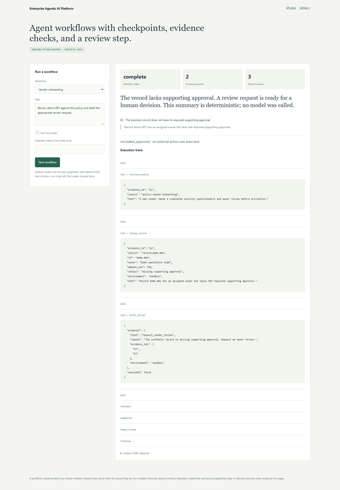
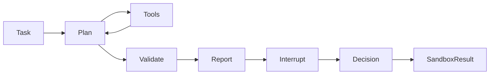

# Enterprise Agentic AI Platform

**[Open the live app](https://enterprise-agentic-platform-s0cj.onrender.com)** · [API documentation](https://enterprise-agentic-platform-s0cj.onrender.com/docs)

A work request should not become an external action just because a model said so.

The application implements ten registered enterprise workflows using LangGraph
and LangChain tool schemas. It reads the workflow policy, checks a synthetic
business record, drafts the permitted review request, validates its evidence,
and pauses with a LangGraph interrupt. A reviewer can resume the saved checkpoint.

SQLite checkpoints survive a local process restart. Record reads require a
run-specific capability. A compare-and-swap reservation prevents two reviewers
from resuming the same pending decision. This is a sandbox: approving a request
never sends an email, initiates a payment, or changes an external system.

Default tool choices are deterministic so the graph can be tested without an API
key. Live mode uses ChatOpenAI to select tools; it requires both an operator token
and server-side model credentials. Exact source quotes are checked before the
report reaches review. Quote membership does not prove that its interpretation
is correct.

## Run the actual application

Python 3.12+:

```bash
git clone https://github.com/charanneelam123-dot/enterprise-agentic-platform.git
cd enterprise-agentic-platform
python -m venv .venv
# Windows: .venv\Scripts\activate
# macOS/Linux: source .venv/bin/activate
pip install -r requirements.txt
uvicorn app:app --host 127.0.0.1 --port 8000
```

Open `http://127.0.0.1:8000` for the working interface and `/docs` for OpenAPI.
The browser calls the Python API; this is not a trace replay.





## API

- `GET /api/workflows`
- `POST /api/runs`
- `GET /api/runs/{id}`
- `POST /api/runs/{id}/decision`

Every app also exposes `GET /health` and `GET /metrics`. Successful responses have
an `X-Trace-ID`. OpenTelemetry spans are generated in process; no external collector
is configured by default. The optional observability configuration is under `ops/`.

## Operator settings

`DATA_DIR` selects the SQLite/artifact directory. It defaults to `runtime/` locally.
For model-backed routes, set `OPENAI_API_KEY`, `OPENAI_MODEL`, and a strong
`ADMIN_API_TOKEN` in the server environment. Supply the operator token in the UI
or the `X-Admin-Token` header. `.env.example` documents names; no file is loaded
automatically. Do not put keys in the repository or client source.

Model calls are opt-in and operator-protected. No paid live-model evaluation was
run during this build. Default examples work without model credentials.

## Checks and deployment

```bash
python -m unittest discover -s tests -v
docker build -t enterprise-agentic-platform .
docker run --rm -p 8000:8000 -e PORT=8000 enterprise-agentic-platform
```

The image runs as an unprivileged user. GitHub Actions tests Python 3.12/3.13 and
builds the Docker image. `render.yaml` declares one free web service with a health
check and a generated operator token. Actual deployment status is documented in
`docs/validation.md`; the presence of a Blueprint is not proof of deployment.

Free hosted instances use ephemeral storage. Restarts can lose records, vector
uploads, and checkpoints; keep the local data directory for persistence or add
an explicitly chosen persistent hosting plan. These projects do not claim
production availability, throughput, or multi-tenant isolation.

This is an independent portfolio implementation using synthetic data. It does
not reproduce an employer's code or establish the historical scale and accuracy
figures in a resume. MIT license.
